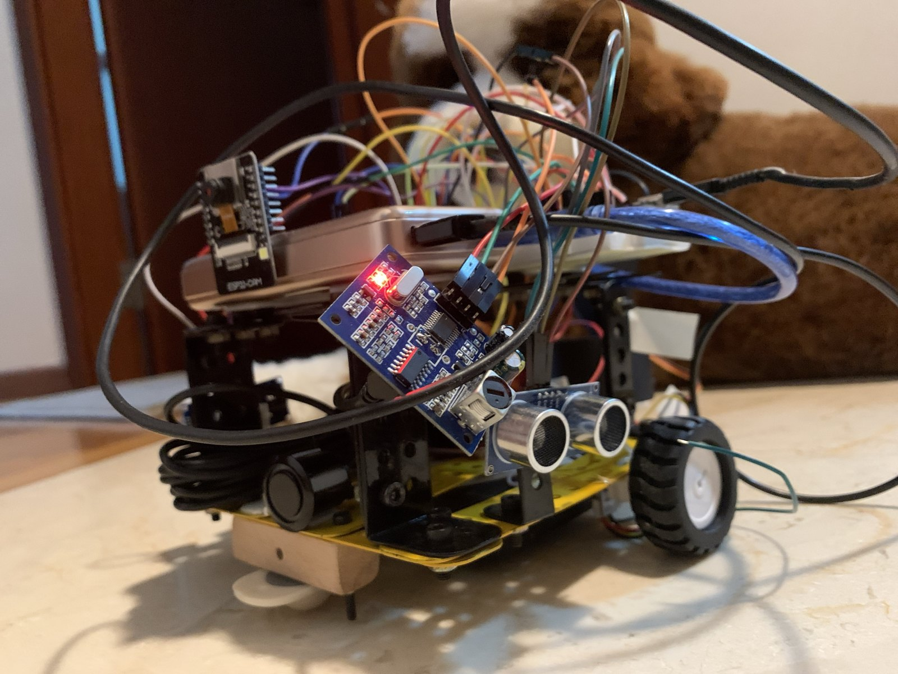
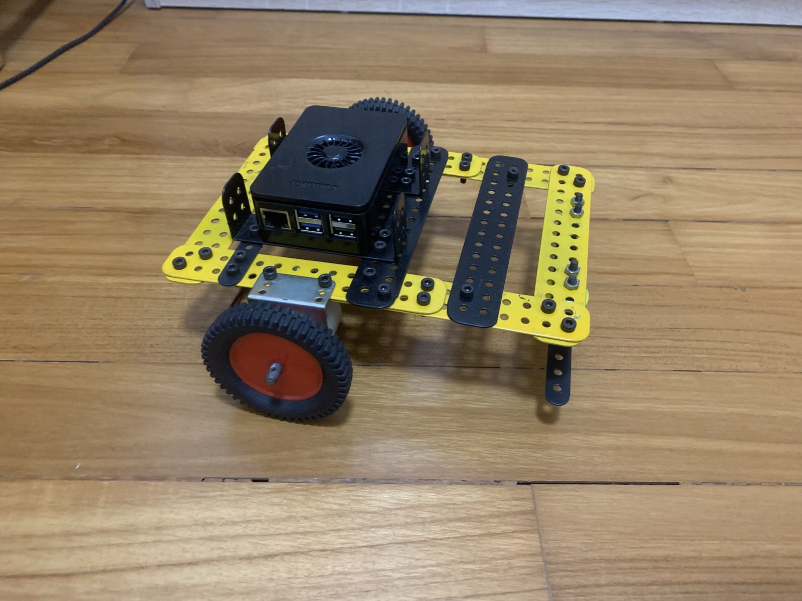
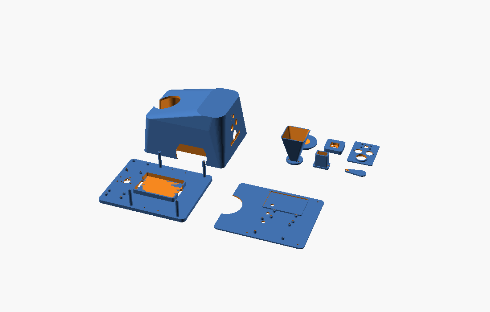
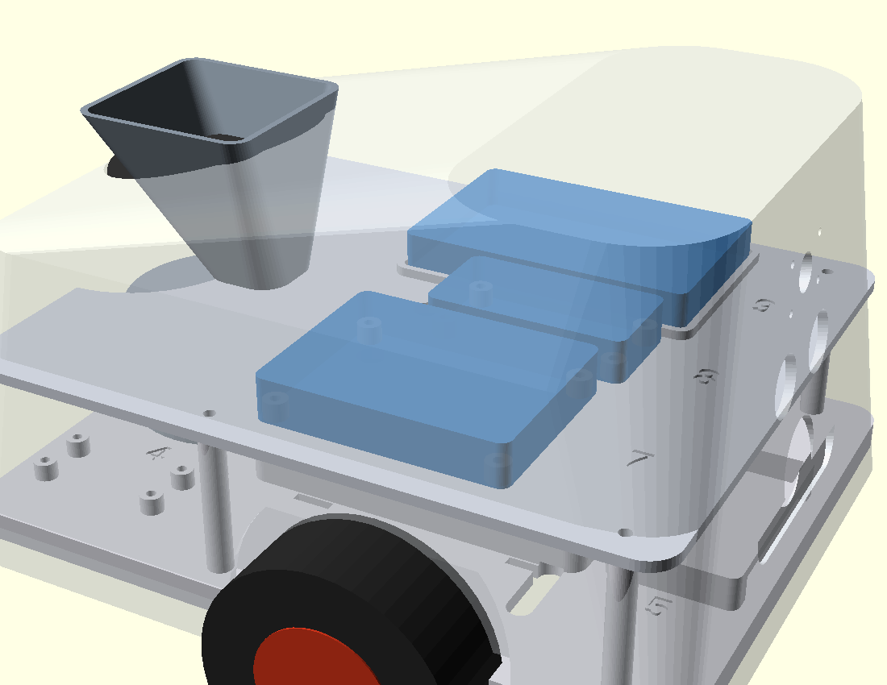
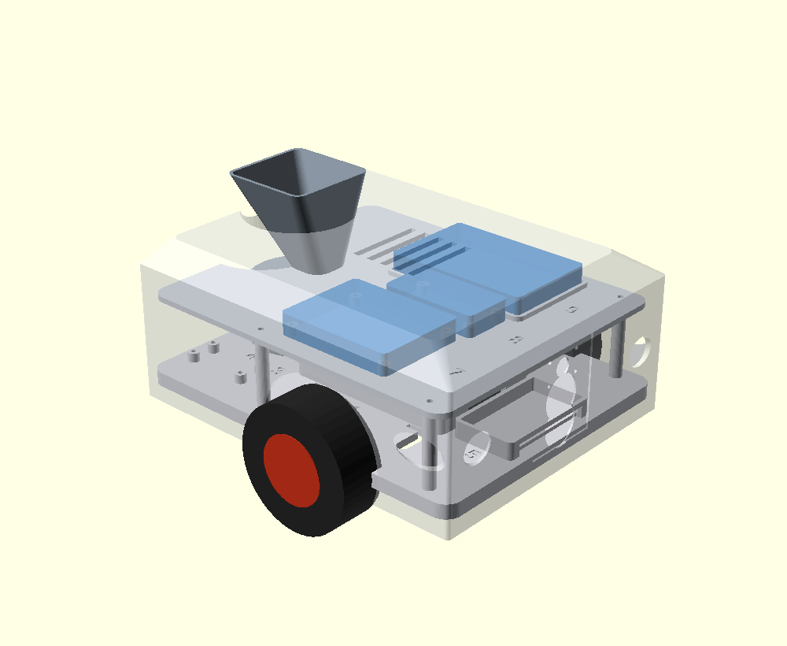
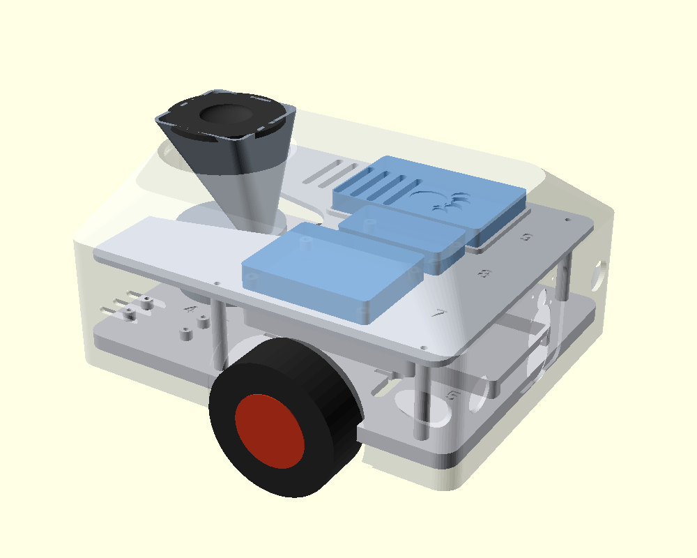
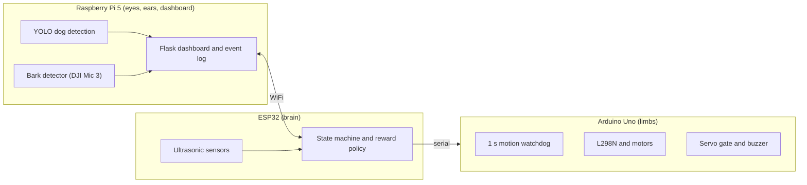

# CANIS

[](https://github.com/Sidsolegend/CANIS/actions/workflows/tests.yml)

A small robot that gives my dog treats for calm behaviour.



*The current robot: a Meccano frame, an ESP32 and an Arduino on a breadboard, an ESP32-CAM on top, and three ultrasonic sensors at the front.*

## Why I built it

My Goldendoodle, Shifu, is afraid of moving objects. He also barks for attention, and he gets into trouble when he is bored. A robot is the worst possible thing to put in front of a dog like that, so the design starts from that constraint. CANIS never punishes him and never drives towards him. It rewards him when he settles, when he leaves a spot he shouldn't be in, or when he stops barking. Any motion is something I introduce slowly and switch off by default.

## What it does

- **Three modes.** `PLACE` (the default) gives a treat when Shifu settles on his mat. `GUARD` stays at a spot, gives a short buzzer cue when he comes near, and rewards him for leaving. `PLAY` wanders the room, gives a treat when it sees him, then backs away so he can follow. It never moves towards him.
- **Dog detection.** A YOLO11n model on a Raspberry Pi 5 finds the dog in the camera image and estimates his bearing and distance. The camera is either the Pi's own or an ESP32-CAM streaming over WiFi.
- **Bark detection.** A DJI Mic 3 connects to the Pi over Bluetooth. After a bark, the robot waits for five seconds of quiet and then drops a treat. A dead or muted microphone is treated as "not quiet", so a failure never rewards the wrong thing.
- **Treat dispenser.** A servo-driven gate on an Arduino Uno, with a short tone before each treat so the sound predicts food. There is a cooldown between treats and a daily cap.
- **Dashboard.** A Flask app on the Pi shows live state, keeps an event log and exports CSV files for the study.
- **Safety layer.** The Arduino stops the motors if it hasn't heard from the ESP32 for one second, so a crashed program or a loose wire ends with a stopped robot. A single exposure setting decides how much motion is allowed at all. It starts at zero.
- **Closed-loop drive (not enabled).** The motors have encoders and the code includes a per-wheel controller and a control-barrier-function safety filter. It is switched off in the config and has not been run on the robot yet.

## How it was built

| | |
|---|---|
|  | **1. Prototype.** The first rolling version: a Meccano frame, a Raspberry Pi 5, and geared motors with large wheels. It proved the vision and treat loop before I committed to a design. |
|  | **2. CAD, version 1.** A fully printable two-tier enclosure, modelled in OpenSCAD for a Bambu P1S. |
|  | **3. CAD, version 2.** A flap-gate dispenser and a shell that closes around the boards. |
|  | **4. CAD, version 3.** A reshaped shell, which I never finished as a full set of parts. |
|  | **5. CAD, version 4.** The last printable design, with the deck and shell checked for slicing. |
|  | **6. What I actually run.** I stopped printing the shell and went back to the metal frame. The dispenser housing is the main printed part. The old motors were replaced with small N20 encoder motors, and the front sensor, ESP32-CAM and bark detection were added. |

The longer story, including what went wrong, is in [docs/BUILD_STORY.md](docs/BUILD_STORY.md).

## Architecture



Each processor does one kind of job, and each one fails on its own. The Uno is deliberately simple. It runs the motors and the gate and stops the wheels when commands stop arriving. The ESP32 reads the sensors and decides what to do. The Pi does the heavy work (vision, audio, logging). More in [docs/ARCHITECTURE.md](docs/ARCHITECTURE.md) and [docs/TECHNICAL_OVERVIEW.md](docs/TECHNICAL_OVERVIEW.md).

## Hardware

| Part | Used for |
|---|---|
| Raspberry Pi 5 | vision, bark detection, dashboard |
| ESP32 DevKit V1 | sensors, state machine, WiFi |
| Arduino Uno | dispenser, motors, buzzer |
| ESP32-CAM (AI-Thinker, OV2640) | camera on the robot |
| L298N driver, 2 x GA12-N20 150 rpm encoder motors, 43 mm wheels | drive |
| 2 x HC-SR04 and 1 x JSN-SR04M-2 | left, right and front distance |
| SG90 servo, small buzzer | treat gate and the marker tone |
| DJI Mic 3 | bark detection, over Bluetooth |
| 6 x AA pack for the motors, a small USB power bank for the electronics | power |
| Meccano frame, printed dispenser housing, castor | chassis |

Wiring, pin tables and power notes: [hardware/WIRING.md](hardware/WIRING.md). Bring-up tests: [hardware/TESTING.md](hardware/TESTING.md). Encoder bring-up: [hardware/ENCODER_BRINGUP.md](hardware/ENCODER_BRINGUP.md).

## Repository layout

```
CANIS_Core/              ESP32 firmware (brain)
Treat_Dispenser_CANIS/   Arduino firmware (dispenser, motors, buzzer)
canis_config.h           every tunable value for the firmware, in one place
vision/                  YOLO dog detection (Pi)
audio/                   bark detection (Pi)
dashboard/               Flask dashboard and event log (Pi)
control/                 closed-loop controller and safety filter (not enabled)
study/                   study protocol and the analysis script
tests/                   118 tests, no hardware needed
hardware/                wiring, bring-up guides, CAD, STL files
docs/                    architecture, safety, interfaces, build story, known issues
paper/                   systems paper draft
crest/                   write-up prepared for a CREST Gold Award submission
prototypes/              early test sketches from before the current firmware
```

## Running it

Run the tests (no hardware needed):

```bash
pip install pytest -r dashboard/requirements.txt
python3 -m pytest tests/ -q
```

Run the dashboard on the Pi:

```bash
cd dashboard
pip install -r requirements.txt
export CANIS_TOKEN=$(openssl rand -hex 16)   # shared secret, also set in arduino_secrets.h
python3 app.py                                # listens on port 5000
```

Flash the firmware: copy `CANIS_Core/arduino_secrets.h.example` to `CANIS_Core/arduino_secrets.h` and fill in your WiFi details, the Pi's address and the token. That file is git-ignored. Then flash `CANIS_Core` to the ESP32 (115200 baud) and `Treat_Dispenser_CANIS` to the Uno (9600 baud).

Start vision and bark detection on the Pi. Setup commands are at the top of each file.

```bash
python3 vision/detect_yolo.py --zone kitchen
python3 audio/detect_bark.py --bt-mac <microphone address>
```

## Status

What has been run:
- The full loop, camera to detection to dashboard to ESP32 to treat, works on the bench.
- The bark loop works end to end: a bark, five seconds of quiet, then a treat. In the live test there were no false positives.
- With a test build that boots straight into `PLAY`, the robot roams on the floor with the battery pack and power bank running everything, no laptop attached. The two motors do not run at the same speed yet, so it drifts. That is what the encoders are for.
- 118 automated tests pass.

What has not:
- The encoders are wired but their counts per turn have not been measured.
- The closed-loop drive and safety filter have never run on the robot.
- The behaviour study has not started. There are no results, and I make no claim that the robot changes Shifu's behaviour. The protocol is in [study/STUDY_PROTOCOL.md](study/STUDY_PROTOCOL.md). It is one dog, one home, one owner.

Known problems and limits are listed in [docs/KNOWN_ISSUES.md](docs/KNOWN_ISSUES.md).

## About the code

I built and wired the robot, ran the bench tests and decided how it should behave around Shifu. AI coding assistants helped write and review parts of the software and the documentation.

## License

MIT. See [LICENSE](LICENSE).
