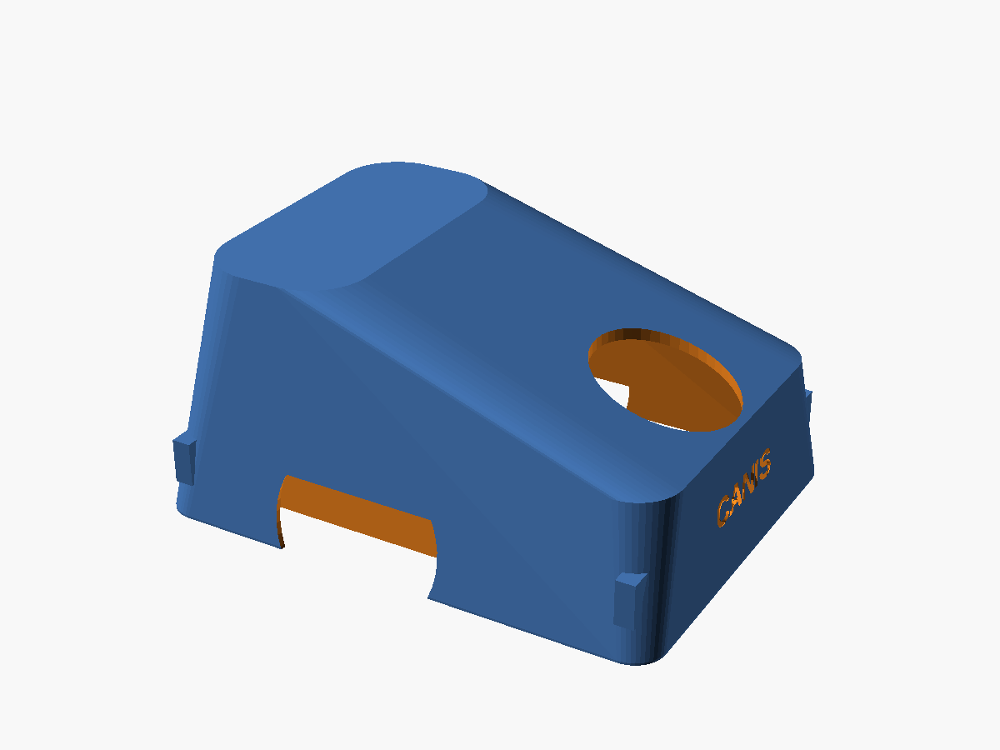
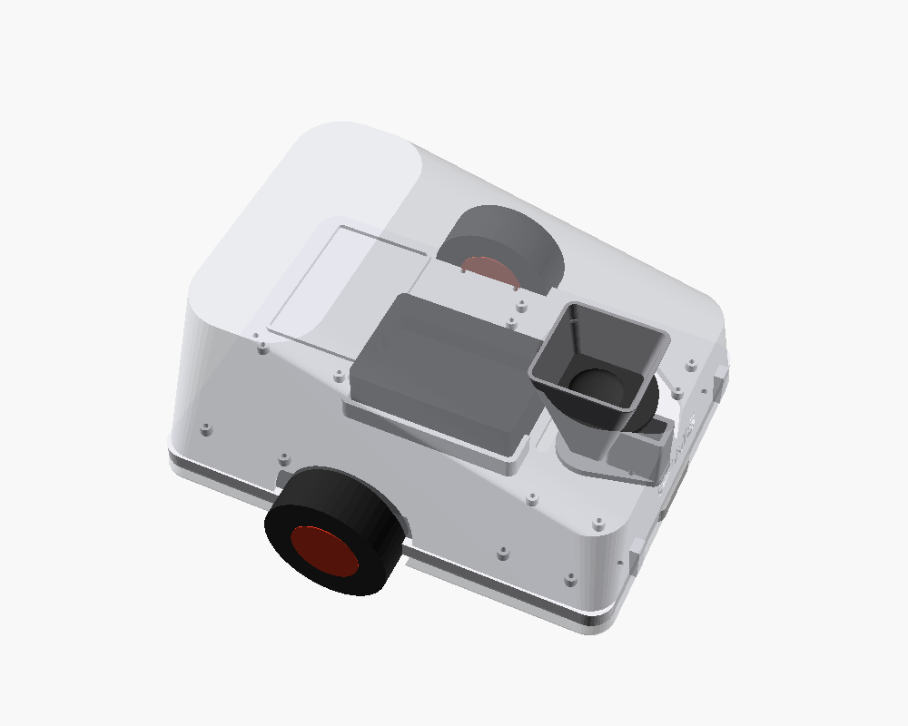
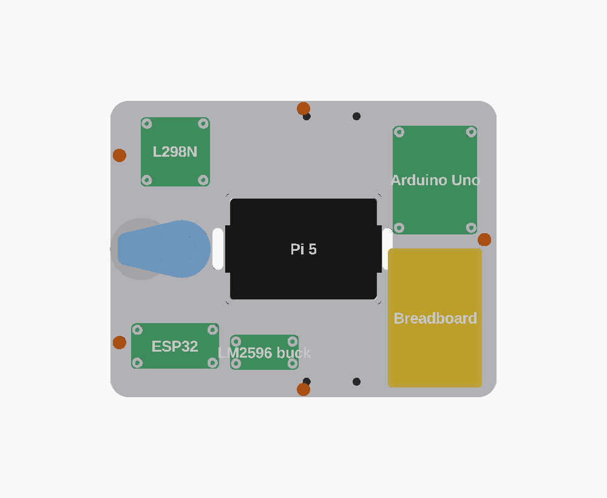
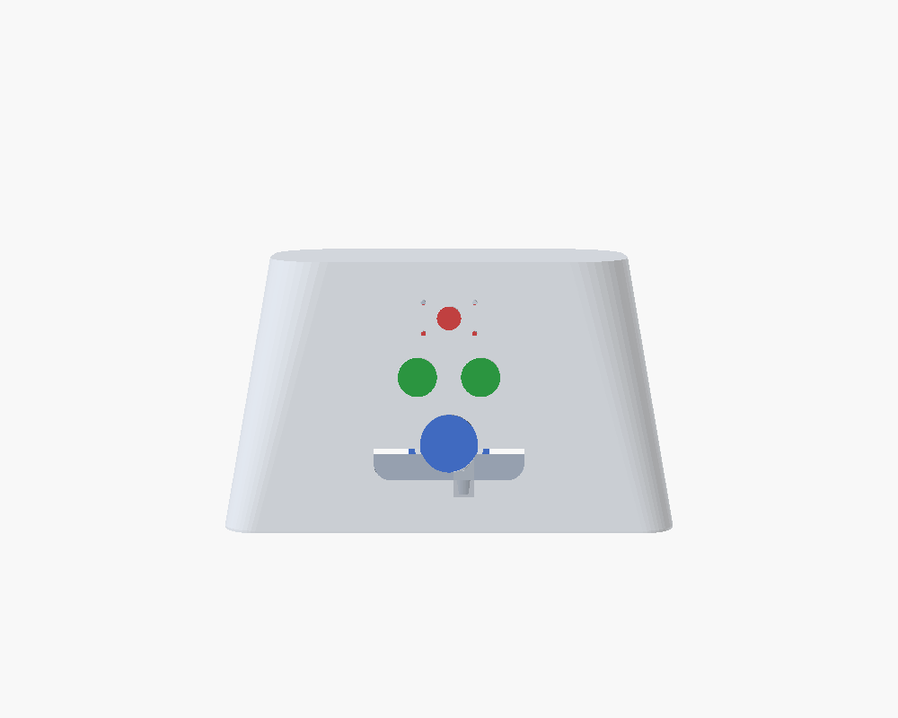

# CANIS — final 3D-printed chassis, enclosure & mounts

Parametric OpenSCAD model for the **hybrid** CANIS build: a clean 3D-printed deck
+ product shell + treat dispenser + rear castor, **reusing your existing metal
motor brackets**. Designed for a **Bambu Lab P1S** (256 bed) in **PLA**.

Design language: one continuous shell with a **paw** motif on the front that holds the
sensors (camera = top toe, the two ultrasonic = beans, PIR = main pad), and a debossed
**CANIS** logo on the rear. Every component — boards *and* sensors — has a real,
supported home, verified collision-free (see the layout map and the sensor-fit view).




---

## Everything fits — the internal layout

`render_part = "layout"` produces this top-down map (also `preview/layout.png`):



| Component | Footprint (mm) | How it mounts | Where |
|-----------|----------------|---------------|-------|
| **Raspberry Pi 5** (CanaKit case) | 92 × 63 | drop-in **cradle** (fence w/ port gaps) | centre |
| **Arduino Uno** | 68 × 53 | 4 open standoffs (M3) — deck stays open underneath for wiring | front-right |
| **Breadboard** (half) | 84 × 55 | perimeter lip locator (adhesive-backed, open centre) | front-left |
| **L298N** motor driver | 44 × 44 | 4 open standoffs | left lane |
| **ESP32** DevKit V1 | 56 × 29 | 4 open standoffs | centre-rear |
| **LM2596** buck converter | 44 × 22 | 4 open standoffs | rear-left |
| **2× DC gearmotors** | 39 × 40 | existing metal brackets → deck holes | mid axle |
| **SG90 servo** | — | inside the dispenser tower | rear |
| **Camera + 2x ultrasonic + PIR** | — | behind the front **paw** (camera=top pad, ultrasonic=beans, PIR=main pad) | front |
| **2× buzzer · button · 1 kΩ · capacitors** | small | on the **breadboard** | front-left |
| **Battery / power bank** (later) | — | drops into the open central floor | centre |

Every board sits on **4 open 5 mm standoffs** so wiring routes underneath, and the deck
has **cable pass-through slots** between zones plus a wire exit behind the Pi.

### Layout is parametric

The whole map is driven by the `COMPONENTS` list at the top of `canis.scad`
(`[name, size_x, size_y, centre_x, centre_y, mount]`). Move a board by editing one
row; the deck's mounting pad follows automatically. Re-render `layout` to re-check fit.

### Sensors are really mounted (not just holes)

Behind the front paw the shell carries actual holders, sized to each board:

| Sensor | Aperture | Holder behind it |
|--------|----------|------------------|
| **HC-SR04** ultrasonic (45×20) | the two 16 mm beans (26 mm pitch) | its two cans press through the snug bean holes (+ a dab of glue) — no rails to clutter |
| **HC-SR501** PIR (33×25) | 23.6 mm main pad | retaining ring the lens housing presses into |
| **Camera** (~25×24) | 9 mm aperture | 4 M2 standoffs at its mount-hole pitch |

The three PCB positions (`paw_cam_z / paw_us_z / paw_pir_z`) are spaced so the boards
**don't collide** behind the face. `render_part = "sensors"` shows the shell with ghost
PCBs in place to prove the fit (`preview/sensors_front.png`):



---

## Parts (each prints flat / as-modelled)

| Part | `render_part` | Notes |
|------|---------------|-------|
| **Deck** | `deck` | 3.4 mm ribbed plate + perimeter skirt. All cradles, pads, holes, cable slots. Load-bearing. |
| **Shell** | `shell` | The enclosure. Front **paw** (sensors), wheel arches, fan grille, hopper hole, rear CANIS logo, 4 hidden screw bosses. |
| **Dispenser** | `dispenser` | Funnel hopper + SG90 tower over the 15 mm throat. |
| **Gate** | `gate` | Paddle on the servo horn; sweeps to release ~one 8 mm kibble. |
| **Lid** | `lid` | Flush cap for the hopper; finger-scoop to pour treats. |
| **Castor spacer** | `castor_mount` | Short 9 mm leveller between the deck and your 25 mm castor (so the deck sits level on 68 mm wheels). |
| **Motor bracket** | `motor_bracket` | *Optional* — only if you retire the metal brackets. |

---

## Structure & weight

- **Deck:** 3.4 mm plate, a **9 mm perimeter skirt**, and **3 transverse ribs** — stiff
  enough to carry the Pi + boards + battery without sag. Print **4 walls / 30 % gyroid**.
- **Shell:** carries no load (cosmetic/protective); **3 walls / 12–15 % infill**.
- **CoG:** drive axle is nudged forward so the centre of mass sits between the wheels
  and the rear castor — no tipping, no dragging skid.
- The robot is intentionally **slow** (gradual fear-conditioning), so the two small
  gearmotors don't need to be fast — they only need to move it gently, which they do.

---

## Print settings (P1S / PLA)

| Part | Orientation | Supports | Walls / Infill |
|------|-------------|----------|----------------|
| Deck | flat, ribs down | no | 4 / 30 % |
| Shell | open-side **down** (hollow dome) | **tree** — under the paw, the internal sensor mounts + hopper rim | 3 / 12–15 % |
| Dispenser | hopper opening **up** | no (PLA bridges the throat) | 3 / 20 % |
| Castor / gate / lid | as modelled | no | 3 / 20 % |

Deck ≈ 248 × 190 mm and the shell ≈ 120 mm tall printed this way — both well inside
the P1S 256³ envelope. Print the shell in **matte PLA** and the faceting disappears —
it looks injection-moulded.

## Export STLs

```bash
cd hardware/cad
for p in deck dispenser gate castor_mount shell lid; do
  openscad -D "render_part=\"$p\"" -o "stl/$p.stl" canis.scad
done
```

## Numbers worth confirming (`// CONFIRM`)

- **`castor_spacer_h` (9 mm)** — = *rear ride height − 25 mm castor*. Default assumes the
  deck underside sits at the 34 mm wheel radius; measure the assembled ride height and
  adjust so the deck sits dead level, then reprint just the spacer.
- **Camera** — `cam_lens_d` assumes a ~9 mm aperture; adjust to your module/webcam.
- **`motor_body_w/l`** — only matters if you print the optional motor bracket.
