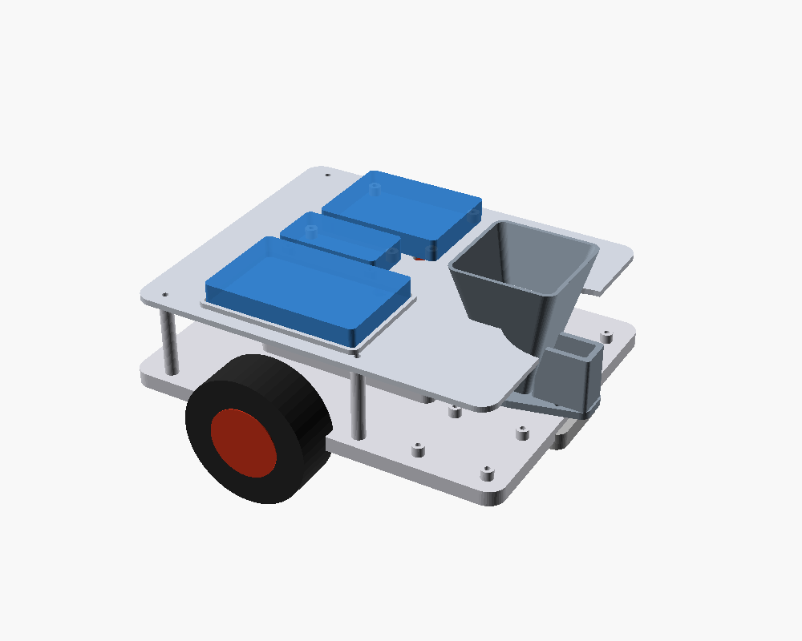
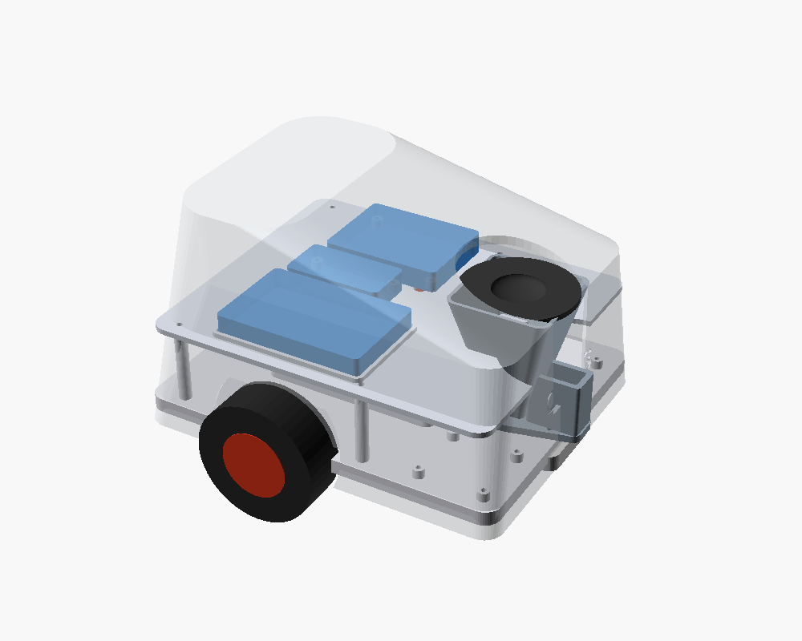
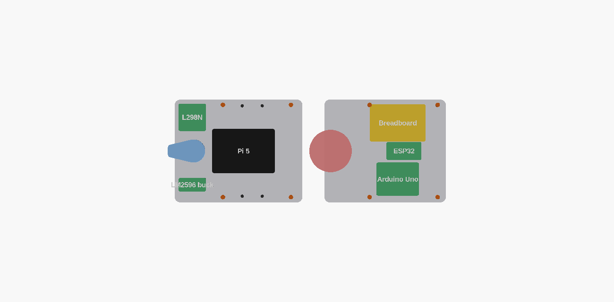

# CANIS — two-tier chassis, enclosure & mounts

Clean rebuild as a **two-tier** robot so everything fits on a compact footprint
(**205 × 165 mm**) instead of one big flat deck. Parametric OpenSCAD, Bambu P1S / PLA,
reusing the existing metal motor brackets.

- **Lower deck** — Raspberry Pi 5, L298N, LM2596 buck, motors, castor, dispenser.
- **Upper shelf** (on 4 standoffs) — Arduino, breadboard, ESP32. A rear **notch**
  lets the dispenser funnel pass up through it.
- **Shell** — clean dome + **paw** front (camera, 2 ultrasonic, PIR). Sensors mount on
  a **separate plate** (no clutter inside the shell).




## Where everything goes (`part = "layout"` → both tiers, real outlines)



| Tier | Components | Mount |
|------|-----------|-------|
| **Lower deck** | Pi 5 (cradle) · L298N · buck · 2 motors · castor · dispenser | cradle / 4 open standoffs / metal brackets |
| **Upper shelf** | breadboard · Arduino · ESP32 | lip locator / 4 open standoffs |
| **Shell paw** | camera · 2× ultrasonic · PIR | **separate `sensor_plate`** (screws to 2 shell bosses) |
| on the breadboard | 2× buzzer · button · 1 kΩ · capacitors | — |

The layout is driven by the `LOWER` / `UPPER` lists at the top of `canis.scad`
(`[name, sx, sy, cx, cy, mount]`). Both tiers share the **same 4 standoff positions**.

## Parts (8) — `part = "<name>"`

| Part | Notes |
|------|-------|
| `deck` | Lower plate (4 mm + skirt, **no ribs**). Pi cradle, board standoffs, 4 shelf standoffs, throat, cable/motor/castor holes. |
| `shelf` | Upper plate. Board mounts + rear **notch** for the funnel + corner screw holes. |
| `shell` | Dome enclosure: paw holes, wheel arches, fan grille, hopper opening, rear CANIS logo, 2 sensor-plate bosses. |
| `dispenser` | Funnel + servo tower on one clean peanut base; tripod feet. |
| `gate` | Paddle on the SG90 horn (releases ~one 8 mm kibble). |
| `lid` | Flush hopper cap. |
| `castor` | 9 mm leveling spacer for the 25 mm castor. |
| `sensor_plate` | **Modular** flat plate: camera standoffs + ultrasonic can-holes + PIR ring. Populate on the bench, screw into the head. |

## Print settings (P1S / PLA)

| Part | Orientation | Supports | Walls / Infill |
|------|-------------|----------|----------------|
| Deck / shelf | flat | no | 4 / 30 % |
| Shell | open-side **down** | tree (paw + hopper rim) | 3 / 12–15 % |
| Dispenser | hopper **up** | no | 3 / 20 % |
| sensor_plate / castor / gate / lid | flat / as-modelled | no | 3 / 20 % |

Export all:
```bash
cd hardware/cad
for p in deck shelf shell dispenser gate lid castor sensor_plate; do
  openscad --export-format binstl -D "part=\"$p\"" -o "stl/$p.stl" canis.scad
done
```

## Confirm before final print (`// CONFIRM`)

- **Camera** — `cam_d` / `cam_hx` / `cam_hy` assume a ~Pi-cam module; set to your part.
- **`castor_spacer_h` (9 mm)** — = rear ride height − 25 mm castor; trim once assembled.
- **`post_h` (42 mm)** — shelf standoff height; must clear your Pi case + cabling.
