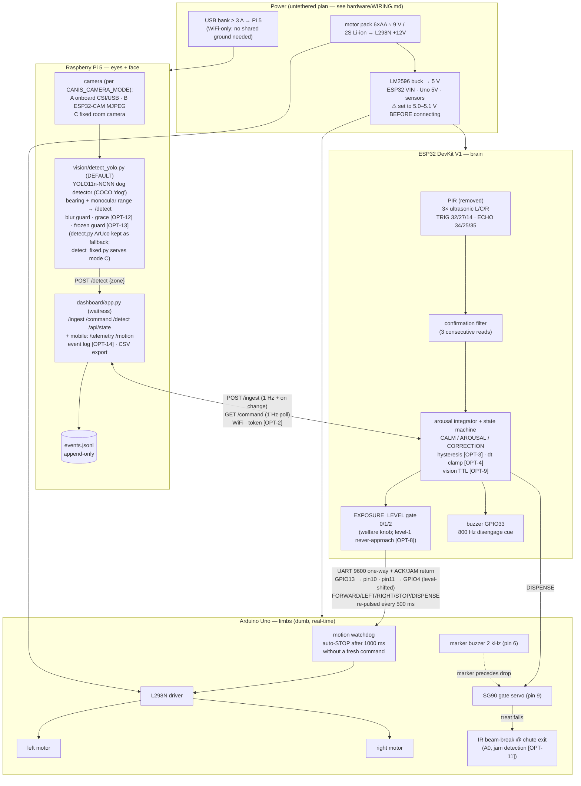
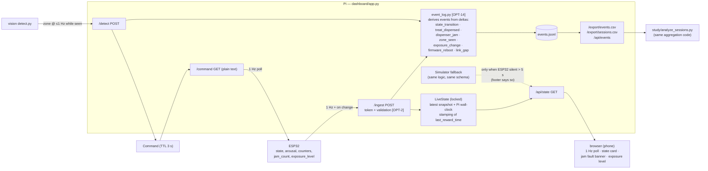
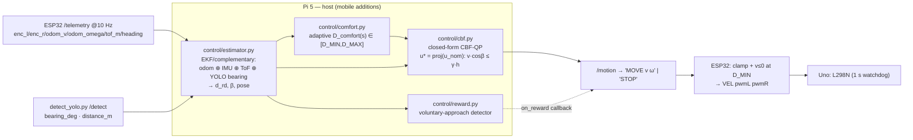
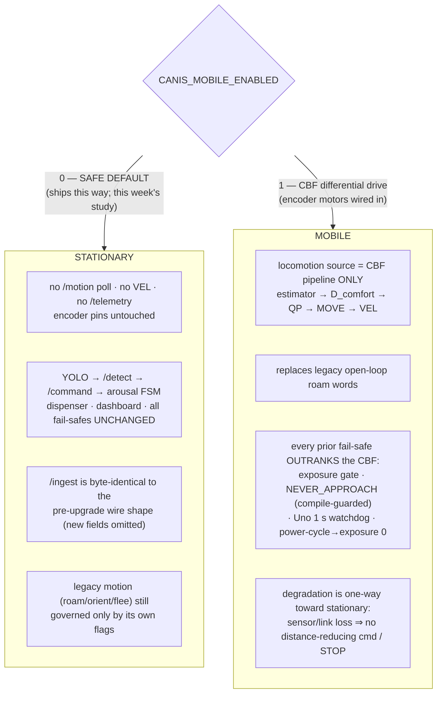
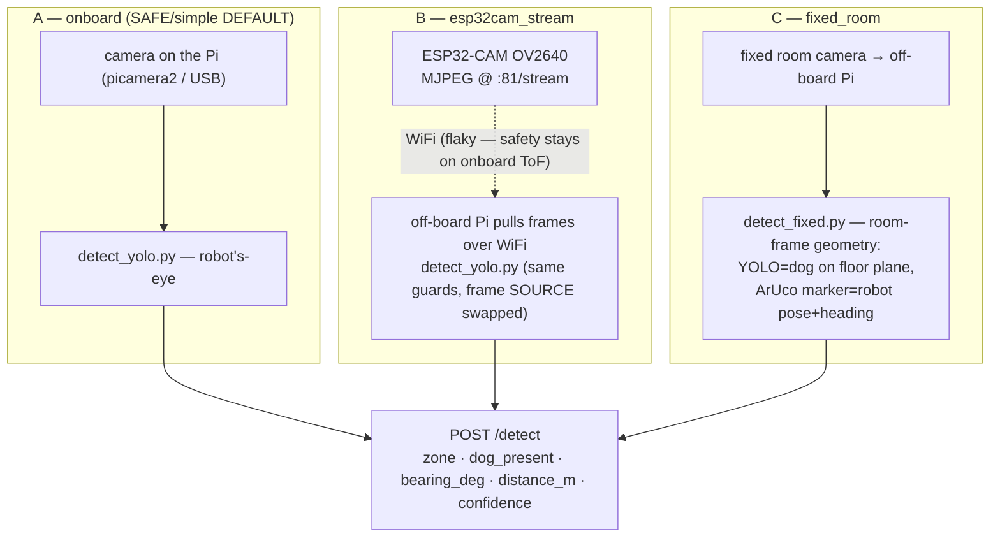

# CANIS — Architecture

Diagrams for the full system as implemented in `optimized/`: the original
behavior plus the `[OPT-n]` hardening (`optimized/OPTIMIZATIONS.md`) and the
mobile-drivetrain / YOLO / CBF upgrade (§§5–7 below; `docs/MOBILE_UPGRADE_STATUS.md`).
§§1–4 describe the system that ships **today** (stationary, `CANIS_MOBILE_ENABLED
= 0`); §§5–7 describe the mobile/camera upgrade layered on top, inert until the
flag is set. All Mermaid — renders on GitHub.

---

## 1. System block diagram (compute, links, power)



Robot-side grounds (ESP32, Uno, sensors, L298N, buck, pack −) are **common**;
the Pi is electrically isolated on its own bank (WiFi-only link).

Failure-domain property this split buys: the *executor* (Uno) needs nothing
alive to stop safely — a crashed brain, dropped wire, or dead WiFi all converge
on "motors stop within ~1 s" (see `docs/SAFETY.md`).

---

## 2. Arousal state machine

Arousal (0–100) is rate-driven: **+30/s** while any confirmed detection is
active (PIR ∨ ultrasonic-zone ∨ vision), **−12/s** always ⇒ net +18/s during
presence, −12/s after departure. Enter/exit thresholds form a Schmitt trigger.

```mermaid
stateDiagram-v2
    direction LR
    [*] --> CALM

    CALM --> AROUSAL : arousal ≥ 20 (ENTER)
    AROUSAL --> CORRECTION : arousal ≥ 70 (ENTER)
    CORRECTION --> AROUSAL : arousal < 60 (EXIT)
    AROUSAL --> CALM : arousal < 12 (EXIT) — 🍖 REWARD (dog disengaged)
    CORRECTION --> CALM : arousal < 12 — 🍖 REWARD + immediate STOP

    CALM : CALM — baseline
    CALM : rewards sustained calm (30 s interval,
    CALM : post-warm-up; 20 s cooldown, 30/session cap)

    AROUSAL : AROUSAL — watch only
    AROUSAL : no intervention of any kind

    CORRECTION : CORRECTION — intervene every 2 s
    CORRECTION : 800 Hz cue (always)
    CORRECTION : exposure 0 → cue only
    CORRECTION : exposure 1 → + pivot toward zone (700 ms, never FORWARD [OPT-8])
    CORRECTION : exposure 2 → + brief approach (400 ms)
```



Timing consequences (unit-tested in `tests/test_state.py`):
sustained presence reaches CORRECTION in ≈ 3.9 s; after departure, release to
CALM (⇒ reward) takes ≈ 4.8 s of decay plus sensor-clear time. A 1 s spurious
blip peaks below 20 and never intervenes.

---

## 3. Treat-dispense sequence (with delivery verification)

```mermaid
sequenceDiagram
    participant FSM as ESP32 state machine
    participant UART as UART link (9600)
    participant UNO as Arduino Uno
    participant DOG as Shifu

    FSM->>FSM: AROUSAL/CORRECTION → CALM transition
    FSM->>FSM: gates: dispenser not FAULTED [OPT-11],<br/>cooldown 20 s ok, session cap < 30 ok
    FSM->>UART: "DISPENSE\n"
    FSM->>FSM: awaitingAck = true (deadline 2.5 s) [OPT-7]
    UART->>UNO: DISPENSE
    UNO->>UNO: stopMotors() (frees Timer2; settle before reward)
    UNO->>DOG: 2 kHz marker, 120 ms
    UNO->>UNO: wait 150 ms (marker→drop gap)
    UNO->>UNO: gate servo 80°→0°, hold 150 ms, close

    alt beam-break sees the treat fall [OPT-11]
        UNO->>UNO: beam interrupted within 600 ms ✓
        UNO->>UART: "ACK\n"
        UART->>FSM: ACK
        FSM->>FSM: rewardCount++ (counts DELIVERY, not intent)
        DOG->>DOG: eats treat (leaving was reinforced)
    else no drop seen
        UNO->>UNO: retry: re-open gate +100 ms, wait 600 ms
        alt retry drops
            UNO->>UART: "ACK\n"
        else still nothing
            UNO->>UART: "JAM\n"
            UART->>FSM: JAM
            FSM->>FSM: jamCount++; 2 consecutive ⇒ FAULTED:<br/>suppress all further auto-rewards<br/>(no marker without a treat) until operator 'd'
        end
    end
```

With `JAM_SENSOR_ENABLED 0` (beam-break not yet installed) the Uno ACKs after
the gate cycle — the pre-[OPT-11] behavior. With `CANIS_USE_DISPENSE_ACK 0`
the ESP32 reverts to count-on-send (no return wire needed).

---

## 4. Dashboard data flow (live view + study record)



Clock ownership: the ESP32 has no wall clock and sends only counters/uptime;
every timestamp in the record is stamped by the Pi at arrival. The event log is
append-only JSONL (schema: `dashboard/event_log.py` docstring), and the session
aggregation used by `/export/sessions.csv` and by the offline analyzer is the
**same function**, so the two can never disagree.

---

## 5. Compute tiers (3-tier split) + the mobile / CBF upgrade

Responsibility is split across three processors by *how fast* and *how
certifiable* each duty must be. The split is unchanged by the mobile upgrade —
the new work lands where it fits the existing tier contract, and none of it runs
unless `CANIS_MOBILE_ENABLED = 1` (SAFE DEFAULT `0`).

| Tier | Device | Existing duty | Added by the mobile/CBF upgrade |
|---|---|---|---|
| **Real-time** | Arduino Uno | dumb executor: motor PWM via L298N, gate servo, marker tone, beam-break; **1 s motion watchdog** | new `VEL <pwmL> <pwmR>` verb (differential drive); does NO kinematics — stays a certifiable executor. Watchdog **unchanged and supreme** |
| **Coordinating** | ESP32 | PIR + 3× ultrasonic, confirmation filter, arousal FSM, exposure gate, buzzer, dispenser logic, WiFi link | reads 2× quadrature encoders on the **PCNT** peripheral (zero-CPU hardware counting); computes odometry `(v, ω)`; streams `/telemetry` @10 Hz; polls `/motion`, clamps `\|v\|/\|ω\|`, re-clamps `v ≤ 0` at `D_MIN`, maps to per-wheel PWM |
| **Host** | Raspberry Pi 5 | vision (`detect_yolo.py`), dashboard, event log, study export | `optimized/control/`: EKF/complementary state estimator (odom ⊕ IMU ⊕ ToF ⊕ YOLO bearing), adaptive `D_comfort(s)`, the closed-form **CBF-QP** safety filter, reward-on-approach |

Why encoders land on the ESP32, not the Uno: the Uno's two hardware interrupts
get tight with two quadrature channels each; the ESP32 PCNT counts in hardware.
This keeps the Arduino a pure executor — the failure-domain property from §1
(the executor needs nothing else alive to stop safely) is preserved.



The barrier is the new **Layer 3** in `docs/SAFETY.md`; wire formats are LAW in
`docs/INTERFACE_CONTRACT.md`; the math is `docs/SAFE_MOTION_CBF_SPEC.md`.

---

## 6. Two operating modes — stationary (default) vs. mobile

One codebase, one compile-time switch (`CANIS_MOBILE_ENABLED`, announced live via
`/config` and `/ingest`). The mode changes only whether the drivetrain stack is
active; every existing fail-safe is in force in both.



**Stationary is the shipped default** and is what runs the conditioning study
this week — no encoder motors required. **Mobile** activates only once the
encoder gearmotors are wired in and the flag is flipped; the compile guard
`CANIS_MOBILE_ENABLED && !CANIS_NEVER_APPROACH → #error` forbids a mobile build
that could drive at the dog. Full semantics: `INTERFACE_CONTRACT.md` §4.

---

## 7. Camera architectures A / B / C (`CANIS_CAMERA_MODE`)

Perception is now a **YOLO dog detector** (`detect_yolo.py`, COCO `dog` class) —
no marker on the dog. ArUco is retained in two places: `detect.py` as a
backward-compatible fallback reporter, and **on the robot** in mode C, where a
DICT_4X4_50 marker (`CANIS_ROBOT_MARKER_ID`=17) localizes the rigid robot while
YOLO finds the dog. All three modes POST the *same* detection contract (§3 of
`INTERFACE_CONTRACT.md`), so the ESP32, controller, and dashboard are
camera-mode-agnostic — you pick by setting one constant, not by rewriting.



| | A `onboard` | B `esp32cam_stream` | C `fixed_room` |
|---|---|---|---|
| View | robot's-eye | robot's-eye | fixed, room-frame |
| Pi location | on the robot | off-board | off-board |
| New hardware | none | 1× ESP32-CAM | fixed camera mount |
| Robot identity | — | — | ArUco marker on robot |
| Reliability | high | streaming is flaky | highest (best study data) |
| Bearing sign | camera frame | camera frame | **robot frame** (preserves `zoneToDir()` left/right) |
| Failure fail-safe | grace → silence | reconnect; **STOP** on stale cmd | marker lost → `distance_m` null; **STOP** on stale cmd |
| When (recommended) | this week (start here) | long-term / room-portable | when going mobile in one room |

Modes B and C put the Pi off-board, so the drive command rides WiFi — see
`SAFETY.md` Layer 3.4 for the added WiFi/stream failure mode (fail-safe: STOP).
Detailed recommendation and sequencing: `docs/MOBILE_UPGRADE_STATUS.md` §5b.
