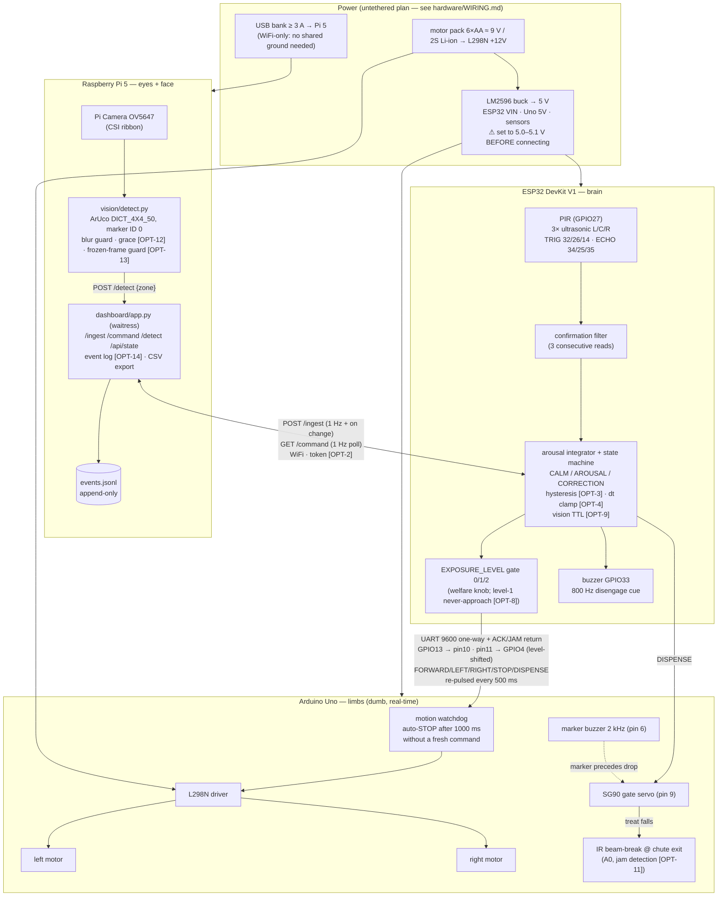
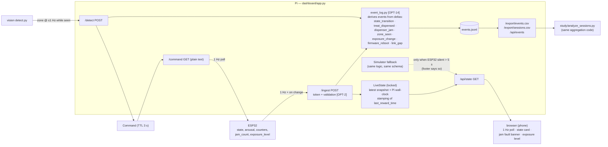

# CANIS — Architecture

Diagrams for the full system as implemented in `optimized/` (behavior identical
to the original tree plus the `[OPT-n]` hardening documented in
`optimized/OPTIMIZATIONS.md`). All Mermaid — renders on GitHub.

---

## 1. System block diagram (compute, links, power)



Robot-side grounds (ESP32, Uno, sensors, L298N, buck, pack −) are **common**;
the Pi is electrically isolated on its own bank (WiFi-only link).

Failure-domain property this split buys: the *executor* (Uno) needs nothing
alive to stop safely — a crashed brain, dropped wire, or dead WiFi all converge
on "motors stop within ~1 s" (see `docs/SAFETY.md`).

---

## 2. Arousal state machine

Arousal (0–100) is rate-driven: **+30/s** while any confirmed detection is
active (PIR ∨ ultrasonic-zone ∨ vision), **−12/s** always ⇒ net +18/s during
presence, −12/s after departure. Enter/exit thresholds form a Schmitt trigger.

```mermaid
stateDiagram-v2
    direction LR
    [*] --> CALM

    CALM --> AROUSAL : arousal ≥ 20 (ENTER)
    AROUSAL --> CORRECTION : arousal ≥ 70 (ENTER)
    CORRECTION --> AROUSAL : arousal < 60 (EXIT)
    AROUSAL --> CALM : arousal < 12 (EXIT) — 🍖 REWARD (dog disengaged)
    CORRECTION --> CALM : arousal < 12 — 🍖 REWARD + immediate STOP

    CALM : CALM — baseline
    CALM : rewards sustained calm (30 s interval,
    CALM : post-warm-up; 20 s cooldown, 30/session cap)

    AROUSAL : AROUSAL — watch only
    AROUSAL : no intervention of any kind

    CORRECTION : CORRECTION — intervene every 2 s
    CORRECTION : 800 Hz cue (always)
    CORRECTION : exposure 0 → cue only
    CORRECTION : exposure 1 → + pivot toward zone (700 ms, never FORWARD [OPT-8])
    CORRECTION : exposure 2 → + brief approach (400 ms)
```



Timing consequences (unit-tested in `tests/test_state.py`):
sustained presence reaches CORRECTION in ≈ 3.9 s; after departure, release to
CALM (⇒ reward) takes ≈ 4.8 s of decay plus sensor-clear time. A 1 s spurious
blip peaks below 20 and never intervenes.

---

## 3. Treat-dispense sequence (with delivery verification)

```mermaid
sequenceDiagram
    participant FSM as ESP32 state machine
    participant UART as UART link (9600)
    participant UNO as Arduino Uno
    participant DOG as Shifu

    FSM->>FSM: AROUSAL/CORRECTION → CALM transition
    FSM->>FSM: gates: dispenser not FAULTED [OPT-11],<br/>cooldown 20 s ok, session cap < 30 ok
    FSM->>UART: "DISPENSE\n"
    FSM->>FSM: awaitingAck = true (deadline 2.5 s) [OPT-7]
    UART->>UNO: DISPENSE
    UNO->>UNO: stopMotors() (frees Timer2; settle before reward)
    UNO->>DOG: 2 kHz marker, 120 ms
    UNO->>UNO: wait 150 ms (marker→drop gap)
    UNO->>UNO: gate servo 80°→0°, hold 150 ms, close

    alt beam-break sees the treat fall [OPT-11]
        UNO->>UNO: beam interrupted within 600 ms ✓
        UNO->>UART: "ACK\n"
        UART->>FSM: ACK
        FSM->>FSM: rewardCount++ (counts DELIVERY, not intent)
        DOG->>DOG: eats treat (leaving was reinforced)
    else no drop seen
        UNO->>UNO: retry: re-open gate +100 ms, wait 600 ms
        alt retry drops
            UNO->>UART: "ACK\n"
        else still nothing
            UNO->>UART: "JAM\n"
            UART->>FSM: JAM
            FSM->>FSM: jamCount++; 2 consecutive ⇒ FAULTED:<br/>suppress all further auto-rewards<br/>(no marker without a treat) until operator 'd'
        end
    end
```

With `JAM_SENSOR_ENABLED 0` (beam-break not yet installed) the Uno ACKs after
the gate cycle — the pre-[OPT-11] behavior. With `CANIS_USE_DISPENSE_ACK 0`
the ESP32 reverts to count-on-send (no return wire needed).

---

## 4. Dashboard data flow (live view + study record)



Clock ownership: the ESP32 has no wall clock and sends only counters/uptime;
every timestamp in the record is stamped by the Pi at arrival. The event log is
append-only JSONL (schema: `dashboard/event_log.py` docstring), and the session
aggregation used by `/export/sessions.csv` and by the offline analyzer is the
**same function**, so the two can never disagree.
